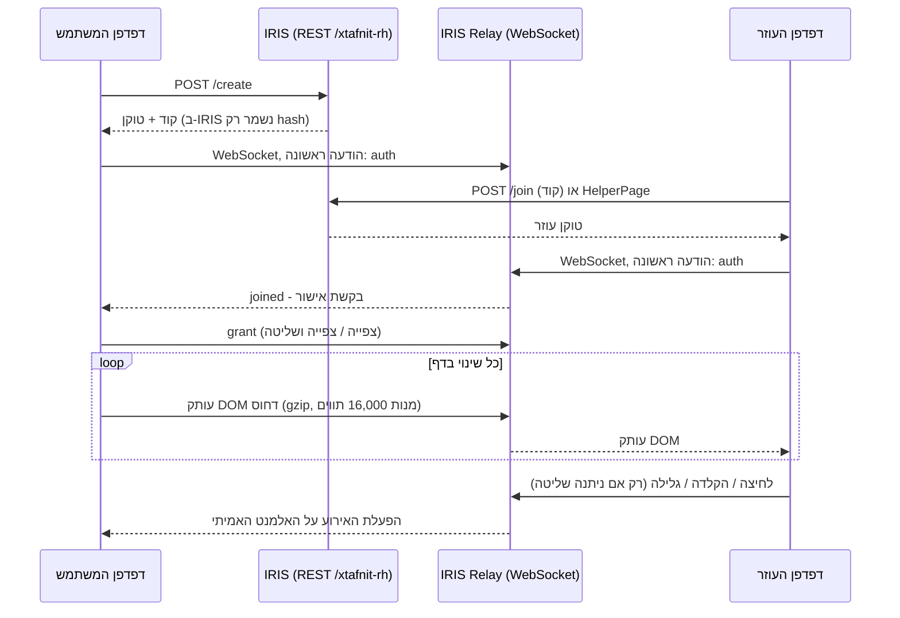

# xTafnit_Helper – עזרה מרחוק ל-xTafnit

המשתמש לוחץ על כפתור צף ומקבל קוד בן 6 ספרות. איש התמיכה מזין את הקוד, ואחרי אישור המשתמש רואה את המסך שלו ויכול לשלוט בו. בלי התקנה אצל המשתמש או העוזר – רק דפדפן. עובד ב-HTTP וב-HTTPS.

## איך זה עובד

לא משודר וידאו: הדפדפן של המשתמש שולח את מבנה הדף (DOM), והעוזר מציג עותק שלו. לכן התעבורה קטנה ואין צורך בתוסף, אבל רואים רק את דף xTafnit – לא את שאר המחשב.



1. **קוד:** `Session` יוצר קוד וטוקן סודי; נשמר רק hash של הטוקן, ב-IRISTEMP.
2. **חיבור:** כל צד פותח WebSocket ל-`/xtafnit/...Relay.cls`. הקוד והטוקן נשלחים בהודעה הראשונה – לא ב-URL, כדי שלא יירשמו בלוגים של IIS. בלי אימות תוך 5 שניות השרת מנתק.
3. **אישור:** המשתמש בוחר צפייה בלבד / צפייה ושליטה / דחייה. ההרשאה נאכפת בשרת.
4. **שיקוף:** אחרי כל שינוי או גלילה (MutationObserver, השהייה של 350ms) הדף מועתק, סקריפטים מוסרים, סיסמאות, שדות `hidden` ושדות `data-rh-mask` מרוקנים, ונשלחים ערכי טפסים ומיקומי גלילה. iframes מאותו origin (למשל `pdfViewer`) נכנסים לעותק כ-`srcdoc`, עד 3 רמות, ו-canvas שנראה על המסך (למשל עמוד PDF) נשלח כתמונת JPEG. אצל העוזר העותק מוצג ב-iframe בלי הרשאה להריץ סקריפטים.
5. **שליטה:** אירועי העוזר נשלחים עם מזהה האלמנט (`data-rhid`) ומופעלים על הדף האמיתי. לשדה סיסמה העוזר לא יכול להקליד.
6. **סיום:** "סיים" מכל צד, תפוגה (`MAXSESSION`), או מדיניות כניסה למערכת (`LOGINPOLICY`).

ה-Relay הוא תור ב-`^IRIS.Temp.xTafnitRH` לכל קוד וצד; תהליך ה-WebSocket של כל צד קורא ממנו כל 0.2 שניות.

## רכיבים

| רכיב | תפקיד |
| --- | --- |
| `TafnitCore.System.UI.App.Tools.Helper.Session` | סשנים, קודים, הצטרפות, חסימות, פרמטרים לכל כתובת (`Param()`) |
| `TafnitCore.System.UI.App.Tools.Helper.API` | REST (`%CSP.REST`) בנתיב `/xtafnit-rh`: `create`, `join`, `close` |
| `TafnitCore.System.UI.App.Tools.Helper.Relay` | WebSocket (`%CSP.WebSocket`): אימות, הסכמה, העברת הודעות |
| `TafnitCore.System.UI.App.Tools.Helper.HelperPage` | מסך עוזר ב-xTafnit – לעוזר מחובר, קוד בלבד |
| `TafnitCore.System.UI.App.Tools.Helper.WebFiles` | `xtafnit-rh.js`, `helper.html` והרוטינה, משובצים ב-base64 (נוצר ע"י `tools/build-webfiles.ps1`) |
| `TafnitCore.System.UI.App.Tools.Helper.Install` / `AutoInstall` | התקנה אוטומטית ברקע אחרי טעינת החבילה (Projection) |
| `core.TafnitHelperUtils` | רוטינת ההתקנה המלאה (`install`) |
| `TafnitCore.System.UI.App.commonXTafPage` | **מחלקת ליבה של הפריימוורק** – `AddRemoteHelpButton`: הכפתור הצף בכל מסך שיורש ממנה |
| `web/xtafnit-rh.js` | צד הדפדפן: משתמש ועוזר |
| `web/helper.html` | מסך עוזר עצמאי, קוד בלבד (UTF-8 **עם BOM** – IRIS מגיש ‎.html כ-ISO-8859-8) |

**במה הפתרון נעזר:** בדפדפן – WebSocket, MutationObserver, fetch, sessionStorage, DOMParser, iframe `srcdoc` + `sandbox`, ו-CompressionStream (אופציונלי). בשרת – IIS עם InterSystems Web Gateway (`CSPms`) ו-WebSocket Protocol, IRIS (`%CSP.REST`, `%CSP.WebSocket`, IRISTEMP), ובפריימוורק xTafnit – `floatButton` (Kendo FAB) ו-`AddResourceToLoad`.

## דרישות

| היכן | מה נדרש |
| --- | --- |
| שרת – IRIS | xTafnit מותקן (נבדק על IRIS 2025.1.5), namespace `TAFNIT_PARAMETERS`, משתמש התקנה עם `%Admin_Secure` ו-`%System_CallOut` |
| שרת – IIS | InterSystems Web Gateway ל-IIS (`CSPms`), רכיב WebSocket Protocol (ההתקנה מתקינה אם חסר), תעודה ל-HTTPS (מומלץ) |
| שרת – רישיונות | בזמן סשן: רישיון חיבור IRIS למשתמש ולעוזר. כשהרישיונות נגמרים `/xtafnit-rh` מחזיר 503 |
| תחנת המשתמש | דפדפן מודרני עם JavaScript; גישה לשרת בכתובת של xTafnit; WebSocket (`ws`/`wss`) לא חסום ב-proxy / firewall |
| תחנת העוזר | דפדפן מודרני; גישה לשרת (גם בכתובת חיצונית); IP מורשה אם `HELPERIPS` מוגדר; כניסה ל-xTafnit רק ל-`HelperPage` |

## מה נתמך ומה לא

| נתמך | לא נתמך / מוגבל |
| --- | --- |
| HTTP ו-HTTPS באותה תצורה (`ws:` / `wss:` לפי הדף) | iframes מאתר אחר (origin אחר) – לא נגישים לסקריפט ולכן לא משוקפים; וידאו |
| iframes מאותו origin, כולל `pdfViewer` (PDF.js) ו-iframe של xTafnit – צפייה, גלילה ולחיצות | canvas מחוץ למסך נשלח ריק (נשלח כשהוא נגלל לתצוגה); canvas שמצויר מתוכן של אתר אחר |
| canvas שנראה על המסך (עמודי PDF, גרפים, חתימה) – כתמונת JPEG | |
| Chrome / Edge / Firefox / Safari במחשב | חלונות מערכת של הדפדפן (alert, בחירת קובץ, הדפסה) וכל מה שמחוץ לדף xTafnit |
| משתמש ב-Safari ב-iOS / iPadOS וב-Chrome ב-Android (דחיסה מ-iOS 16.4) | מחוות מגע (swipe, pinch, לחיצה ארוכה) לא מועברות לעוזר |
| כמה כתובות שרת, פרמטרים נפרדים לכל אחת | עוזר בטלפון – צפייה בלבד בפועל (מקשים ועכבר לא זמינים) |
| עוזר חיצוני (`helper.html`) או מחובר (`HelperPage`) | אפליקציה עטופה (Cordova / WebView) – דורשת כתובת שרת מלאה ב-`XRH_CONFIG` ו-CORS |
| reverse proxy (עם `TRUSTPROXY=1` והעברת `Upgrade` / `Connection`) | במעבר אפליקציה / נעילת מסך במובייל החיבור נקטע ומתחבר מחדש בחזרה |

נבדק בפועל: מחשב, HTTP (היום דורש `REQUIREHTTPS=0` לכתובת), כולל ההתקנה האוטומטית. HTTPS ומובייל – לפי היכולות שהקוד משתמש בהן, לא נבדקו במכשיר.

## התקנה

בטרמינל של IRIS, ב-namespace של xTafnit, עם משתמש בעל `%Admin_Secure` ו-`%System_CallOut`:

```
zn "MATRIXSYS"
do $system.OBJ.LoadDir("C:\gitRepository\xTafnit_Helper\src","ck",,1)
```

בסוף הקומפילציה ההתקנה המלאה רצה **ברקע** בלי פרמטרים: IIS (handlers, ‏CSPms, ‏WebSocket Protocol), ‏Web Application ‏`/xtafnit-rh` עם role לקריאה בלבד, קומפילציה, קבצי הווב (מתוך `WebFiles`), ובדיקת חיבור. אם `LoadDir` לא טוען את ה-`.mac`, ההתקנה כותבת את הרוטינה מהעותק שב-`WebFiles`.

- הלוג: `zw ^TafnitHelper("InstallLog")`, ושורה ב-`messages.log`.
- הרצה ידנית: `do install^core.TafnitHelperUtils()`
- עם HTTPS: `do install^core.TafnitHelperUtils("","",,1,,,"<THUMBPRINT>")` – יוצר binding של 443 עם התעודה (`LocalMachine\My`).
- ביטול ההפעלה האוטומטית: `set ^TafnitHelper("AutoInstall")=0`
- התקנה חוזרת רק מקשיחה: היא לא מבטלת `sslFlags` שהוגדר, ולא מפעילה מחדש Web Application שהושבת.
- `/xtafnit-rh` מותקן עם Unauthenticated בלבד. HTTP Basic בבקשת `join` (משאב `xTafnit_RemoteSupport`): `set ^TafnitHelper("BasicAuth")=1` והתקנה מחדש.
- **עורך פתוח:** אם המחלקות פתוחות ב-Studio / VS Code, הקומפילציה נכשלת (`ERROR #5864`) – לסגור לפני ההתקנה.

פרמטרים של `install^core.TafnitHelperUtils` (כולם אופציונליים):

| פרמטר | ברירת מחדל | משמעות |
| --- | --- | --- |
| `srcDir` | ריק | תיקיית מקור. ריק = קומפילציה של מה שטעון וקבצי ווב מ-`WebFiles` |
| `hosts` | ריק | כתובות (`SERVER_NAME`) שבהן יופעל הכפתור, מופרדות בפסיק |
| `pages` | `TafnitCore.System.UI.App.Login` | מסכים שבהם יופעל הכפתור, מופרדים בפסיק |
| `resetIIS` | 0 | 1 = `iisreset` בסוף (אחרי התקנת WebSocket Protocol) |
| `site` | `Default Web Site` | אתר ה-IIS |
| `webRoot` | `C:\inetpub\wwwroot\` | תיקיית השורש של האתר |
| `httpsCert` | ריק | thumbprint של תעודה – binding של `https:443` |
| `requireSSL` | 0 | 1 = `/xtafnit-rh` ו-`helper.html` רק ב-HTTPS גם ברמת IIS. 0 = ההגדרה הקיימת לא משתנה (התקנה חוזרת לא מבטלת הקשחה) |

## הפעלת הכפתור למסכים

הכפתור מוצג רק במסכים ובכתובות שהוגדרו (`{host}` = `SERVER_NAME`, אותה שורה ל-HTTP ול-HTTPS):

```
set ^["TAFNIT_PARAMETERS"]xTafnitParams("BaseURLs","erp.example.co.il","helper","TafnitCore.System.UI.App.Login")=1
```

## פרמטרים לכל כתובת

כל הפרמטרים נמצאים תחת `^["TAFNIT_PARAMETERS"]xTafnitParams("BaseURLs",{host},"helper",{PARAMETER})` ונכנסים לתוקף מיד. בלי הגדרה – ברירת המחדל של `Session`.

קוד נוצר רק בכתובת שיש לה הגדרה כלשהי תחת `"helper"` (למשל המסך שבו מופעל הכפתור). הכתובת נשמרת בסשן, וכל הפרמטרים של ההצטרפות נקראים לפיה – לא לפי כותרת `Host` של העוזר.

| פרמטר | ברירת מחדל | משמעות |
| --- | --- | --- |
| `{מחלקת מסך}` | – | 1 = הכפתור הצף מוצג במסך הזה בכתובת הזו |
| `HELPERIPS` | ריק = כל IP | כתובות/קידומות IP מורשות לעוזר, מופרדות בפסיק (`10.0.5.`) |
| `ANONYMOUSHELPER` | 0 | 1 = הפעלת הצטרפות עם קוד בלבד, בלי הזדהות (`helper.html`). מומלץ רק יחד עם `HELPERIPS` |
| `HELPERS`,{USERCODE} | לא מוגדר = כל משתמש מחובר | רשימת עוזרים מורשים ב-`HelperPage` |
| `TRUSTPROXY` | 0 | 1 = כתובת הלקוח מהערך האחרון ב-`X-Forwarded-For` – זה שה-proxy הוסיף (רק מאחורי proxy אמין) |
| `CODETTL` | 600 | תוקף הקוד בשניות |
| `MAXSESSION` | 3600 | משך סשן פעיל בשניות |
| `MAXFAILS` / `LOCKSECS` | 5 / 900 | ניסיונות שגויים עד חסימה / משך החסימה |
| `MAXCREATES` | 5 | קודים מאותו IP ב-10 דקות |
| `REQUIREHTTPS` | 1 | 1 = קוד נוצר ועוזר מצטרף רק ב-HTTPS. 0 = גם HTTP (סביבת בדיקות). מאחורי proxy שמסיים TLS: `TRUSTPROXY=1` ו-`X-Forwarded-Proto: https` |
| `LOGINPOLICY` | `reconsent` | אחרי כניסה למערכת: `reconsent` / `end` / `continue` |

## אבטחת מידע

- **טופל:** HTTPS נדרש כברירת מחדל (`REQUIREHTTPS`); שדות `hidden`, מזהי סשן של CSP בכתובות ושדות סיסמה (גם אחרי "הצג סיסמה") לא נשלחים לעוזר; הזדהות Password על ה-REST כבויה; הגבלת חיבורים לא מאומתים, נפח הודעות ועומק תור ב-Relay, וניקוי תקופתי של IRISTEMP; פרמטרי האבטחה נקראים לפי הכתובת שבה נוצר הקוד ולא לפי כותרת `Host` של העוזר; הצטרפות בלי הזדהות כבויה כברירת מחדל; העותק אצל העוזר מוצג עם CSP (משאבים רק מהשרת עצמו, בלי frames מכתובת, בלי `meta refresh`) ועם תקרת גודל; הטוקן לא נכנס ל-URL; ל-`/xtafnit-rh` יש role `xTafnitRemoteHelp` עם קריאה בלבד והסשנים ב-IRISTEMP; נשמר רק hash של טוקנים; הגנת CSRF בכותרת `X-RH`; סיסמאות לא נשלחות לעוזר; העותק מוצג אצל העוזר בלי סקריפטים; השליטה דורשת אישור והמשתמש יכול לבטל בכל רגע.
- **מומלץ בייצור:** תעודה ל-HTTPS (`httpsCert`, אפשר גם `requireSSL`); `HELPERIPS` והגבלת IP ב-IIS לרשת התמיכה; `ANONYMOUSHELPER=1` רק אם חייבים עוזר חיצוני, ורק יחד עם `HELPERIPS`; bindings ב-IIS עם שם host מפורש; Dynamic IP Restrictions ב-IIS על `xtafnit-rh` (מיצוי רישיונות); הפעלת אירועי האודיט `xTafnit/RemoteHelp/*`; סימון שדות רגישים ב-`data-rh-mask`.
- **לתשומת לב:** `commonXTafPage` היא מחלקת ליבה – השינוי צריך להיכנס לפריימוורק, אחרת יידרס בעדכון.

## פיתוח

- אחרי שינוי ב-`web/` או ב-`src/core.TafnitHelperUtils.mac` – להריץ `tools/build-webfiles.ps1` ולעשות commit גם ל-`WebFiles.cls`.
- בשינוי ברוטינה – להעלות יחד את `version()` ואת `Install.VERSION`.
- דפדפנים שומרים את `xtafnit-rh.js` במטמון (`?v=...`) – להעלות את גרסת הפריימוורק או Ctrl+F5.
- הגדרות בדפדפן (`window.XRH_CONFIG` לפני טעינת הסקריפט): `frameDepth` (ברירת מחדל 3 – רמות iframe משוקפות), `canvasQuality` (0.7 – איכות JPEG), `snapDelay` (350ms), `chunk` (16000).

## מסכים

- **משתמש:** הכפתור הצף בכל מסך שיורש מ-`commonXTafPage` ומופעל בפרמטרים.
- **עוזר מחובר:** `xpage.csp?eTafnitClass=TafnitCore.System.UI.App.Tools.Helper.HelperPage` – קוד בלבד.
- **עוזר עצמאי:** `/xtafnit/helper.html` – קוד בלבד. דורש `ANONYMOUSHELPER=1` לכתובת.
- העותק אצל העוזר הוא תוכן מהמחשב של המשתמש: אין להקליד בו סיסמאות או פרטי הזדהות של העוזר (מוצגת על כך שורת אזהרה).
